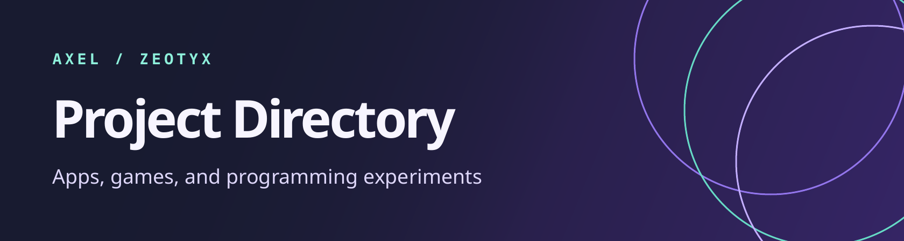

  

  <a href="#projects">Browse projects</a> ·
  <a href="#original-collection">Original collection</a> ·
  <a href="https://github.com/zeotyx">GitHub profile</a>

<h2>Projects</h2>

<table width="100%">
<tr>
<td width="50%" valign="top">
<strong>PYTHON · AUTOMATION</strong>
<h3><a href="https://github.com/zeotyx/jarvis-ai">Jarvis AI ↗</a></h3>

Voice assistant and desktop automation experiments.

</td>
<td width="50%" valign="top">
<strong>C# · GAMES</strong>
<h3><a href="https://github.com/zeotyx/game-experiments">Game Experiments ↗</a></h3>

Early RPGs, simulations, and graphics experiments.

</td>
</tr>
<tr>
<td width="50%" valign="top">
<strong>C# · C++ · PYTHON</strong>
<h3><a href="https://github.com/zeotyx/math-and-ml-experiments">Math &amp; ML Experiments ↗</a></h3>

Calculators, science utilities, and introductory neural networks.

</td>
<td width="50%" valign="top">
<strong>PYTHON · C++</strong>
<h3><a href="https://github.com/zeotyx/desktop-utilities">Desktop Utilities ↗</a></h3>

Small tools for passwords, weather, and webcam capture.

</td>
</tr>
<tr>
<td width="50%" valign="top">
<strong>C# · NETWORKING</strong>
<h3><a href="https://github.com/zeotyx/ipx-tool">IPX Tool ↗</a></h3>

The original C# source for IPX Tool 0.6.

</td>
<td width="50%" valign="top">
<strong>PYTHON · FLASK</strong>
<h3><a href="https://github.com/zeotyx/iss-dashboard">ISS Dashboard ↗</a></h3>

ISS speed views and dashboard templates.

</td>
</tr>
</table>

<h2>Original collection</h2>

The archive keeps the original project layout, Git history, and compiled calculator build. <a href="https://github.com/zeotyx/Main/tree/archive/original-projects">Browse the archive ↗</a>

